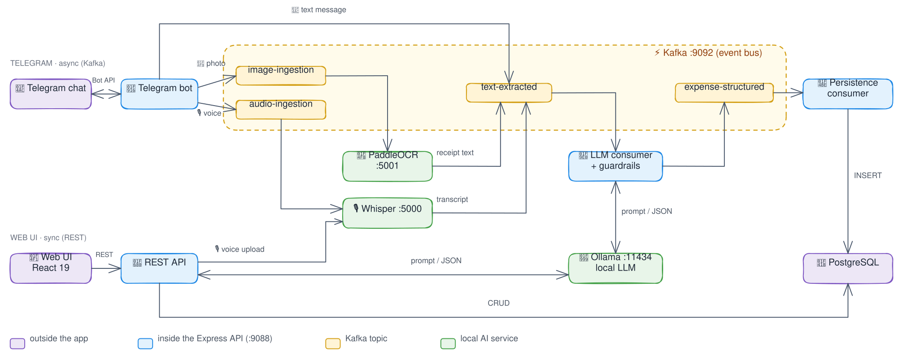

# 🎙️ SenseLedger - 100% Local Multi-Modal AI Expense Tracker

SenseLedger is a full-stack, 100% local, multi-modal AI expense tracker designed for **Web**, **Mobile**, and **Telegram**. It allows you to speak naturally, snap photos of receipts, or send quick text shorthand to automatically track expenses, incomes, and account transfers in Indian Rupees (₹) with zero cloud API costs and total privacy.

---

## 🌟 Key Features

- **🎙️ Voice Note Transcription**: Instant Speech-to-Text via OpenAI Whisper (`tiny.en`), processing voice notes and `.mp3`/`.ogg` audio files.
- **📸 Receipt & Invoice OCR**: Optical Character Recognition using PaddleOCR (`PP-OCRv4`) with automated decimal/currency normalization.
- **🤖 Telegram Bot Gateway**: Send voice notes, receipt photos, or text messages directly in Telegram with live processing status updates.
- **⚡ Event-Driven Backbone**: Apache Kafka (KRaft mode) decouples ingestion from AI perception and database writes for non-blocking performance.
- **🧠 100% Local LLM Extraction**: Uses Ollama (`llama3.2:1b` or `llama3`) with dynamic taxonomy injection to parse amount, category, subcategory, account, and transaction type.
- **✏️ Interactive Telegram Actions**: Every recorded transaction in Telegram includes inline `🗑️ Delete` and `✏️ Correct` buttons with multi-turn natural language correction.
- **💬 Ask Your Ledger (AI agent)**: Ask *"How much did I spend on food in October vs September?"* or *"Which account is running low?"* in the web UI or Telegram. A local tool-calling agent answers from your data through validated, read-only tools, and refuses what the ledger can't answer. See [docs/AGENT.md](./docs/AGENT.md).
- **🏦 Multi-Account Management**: Real-time balance calculations for Cash, Bank Accounts, Credit Cards, and Wallets with inter-account fund transfers.
- **📊 Analytics & Visualizations**: Interactive Doughnut charts powered by Chart.js with dynamic category breakdown badges.
- **🇮🇳 Indian Rupee (`₹`) Standard**: Native Indian currency formatting (e.g. `-₹ 1,500.00`, `₹ 45,000.00`).
- **🛡️ Heuristic Guardrails & Anti-Hallucination**: Deterministic regex validation and prompt guardrails preventing 1B LLMs from hallucinating amounts on greetings or non-financial speech.
- **📱 Responsive Web UI**: React 19 + Vite frontend scaling smoothly from mobile screens to desktop dashboards.

---

## 🏛️ System Architecture

SenseLedger has two paths into the same PostgreSQL database, sharing the same local AI services:

- **Telegram (top lane): async, through Kafka.** Every input is first turned into **plain text** (voice by Whisper, receipt photos by PaddleOCR, text as is). The LLM consumer then turns that text into a **structured transaction**, and the persistence consumer saves it.
- **Web UI (bottom lane): sync, through REST.** The Web UI reads and edits data through the REST API. A voice recording is processed inside the request (Whisper → Ollama → PostgreSQL), without Kafka.

<p align="center">
  <a href="docs/architecture.svg"></a>
</p>

<sub>Click the diagram to open it full size. Source: <a href="docs/architecture.excalidraw"><code>docs/architecture.excalidraw</code></a>. Open it at <a href="https://excalidraw.com">excalidraw.com</a> to edit, then export it as SVG over <code>docs/architecture.svg</code>.</sub>

- After saving, the bot replies with a summary and **🗑️ Delete** / **✏️ Correct** buttons. Those buttons update the database directly, without Kafka.
- The Telegram bot and both consumers run **inside the Express API process**.
- Media files are passed between containers through the shared `./uploads` volume. Kafka events carry only the file path.

| Kafka topic | Produced by | Consumed by | Carries |
| :--- | :--- | :--- | :--- |
| `audio-ingestion-events` | Telegram handler | Whisper | Voice note file reference |
| `image-ingestion-events` | Telegram handler | PaddleOCR | Receipt photo reference |
| `text-extracted-events` | Whisper, OCR, Telegram (text) | LLM consumer | Raw text |
| `expense-structured-events` | LLM consumer | Persistence consumer | Parsed transaction JSON |

> **Why Kafka?** Transcription, OCR and LLM calls can take seconds (or ~25s on CPU). Queuing them keeps the bot and API responsive, and each stage can fail or scale independently.

👉 For full architecture diagrams, sequence flows, Kafka topic schemas, and entity models, see **[ARCHITECTURE.md](./ARCHITECTURE.md)**.

---

## 🛠️ Microservices & Ports

| Service | Technology | Port | Description |
| :--- | :--- | :--- | :--- |
| **`expense-client`** | React 19, Vite, Nginx | `80:80` (prod)<br/>`5173:5173` (dev) | Web and mobile frontend dashboard. |
| **`expense-api`** | Node.js, Express, Sequelize | `9088:9088` | Backend REST API & Kafka consumer/producer. |
| **`expense-kafka`** | Apache Kafka (KRaft) | `9092:9092` | Event streaming broker. |
| **`expense-kafka-ui`** | Provectus Kafka UI | `8090:8080` (dev) | Web management console for Kafka topics. |
| **`expense-whisper`** | Python, Flask, Whisper | `5000:5000` | Speech-to-text service (`tiny.en`). |
| **`expense-ocr`** | Python, Flask, PaddleOCR | `5001:5001` | Receipt OCR service (`PP-OCRv4`). |
| **`expense-ollama`** | Ollama Engine | `11434:11434` | Local LLM inference engine (`llama3.2:1b`). |
| **`expense-postgres`** | PostgreSQL 15 | `6033:5432` | Relational database. |
| **`expense-prometheus`** | Prometheus | `9090:9090` | Time-series metrics collection & scraping. |
| **`expense-grafana`** | Grafana | `3000:3000` | Pre-provisioned system & AI telemetry dashboards. |
| **`expense-cadvisor`** | Google cAdvisor | `8085:8080` | Real-time container resource monitoring. |

---

## ⚡ Performance & Hardware Benchmarks

SenseLedger is engineered to run seamlessly on consumer hardware (16GB RAM laptops) with minimal resource overhead.

### Resource & Processing Benchmarks (Grafana Telemetry)

| Component | Technology | RAM Footprint | CPU Usage (Burst) | CPU Container Latency | GPU / Metal Latency |
|---|---|---|---|---|---|
| **Speech-to-Text** | Whisper `tiny.en` | ~75 MB | 2.5 Cores | **0.3s – 0.6s** | **~0.10s** |
| **Receipt OCR** | PaddleOCR `PP-OCRv4` | ~120 MB | 2.0 Cores | **0.3s – 0.5s** | **~0.15s** |
| **LLM (2.5k Prompt Ingest)**| Ollama `llama3.2:1b` | ~1.3 GB | 3.5 Cores (100%) | **~22.0s** *(CPU Matrix)* | **~0.15s** *(GPU Parallel)* |
| **LLM (Token Generation)** | Ollama `llama3.2:1b` | ~1.3 GB | 3.0 Cores | **~2.7s** *(18 tok/s)* | **~0.20s** *(120 tok/s)* |
| **Full Voice Pipeline** | End-to-End | **~3.6 GB Peak** | Dynamic Burst | **~25.2s** | **~0.57s (44x Faster)** |
| **Total Stack (Idle)** | 11 Microservices | **~2.1 GB** | **< 2% total CPU** | — | — |

### 🚀 Enabling GPU Acceleration (44x Faster Inference)

Set `AI_DEVICE` in `.env`, then run `docker compose up -d --build`. The default is `cpu`.

- **macOS (Apple Silicon with Metal)**: `AI_DEVICE=metal`
  Docker containers cannot use the Metal GPU, so install and start Ollama natively, then pull the model with `ollama pull llama3.2:1b`. The Ollama container is disabled, and Whisper and OCR stay on CPU. This slashes end-to-end voice-to-card latency from **~25s down to ~0.57s**.
- **Linux / Windows (NVIDIA CUDA)**: `AI_DEVICE=nvidia`
  Install the [NVIDIA Container Toolkit](https://docs.nvidia.com/datacenter/cloud-native/container-toolkit/latest/install-guide.html). Ollama, Whisper and OCR all use the GPU. Set `WHISPER_DEVICE=cpu` or `OCR_DEVICE=cpu` to keep one of them on CPU.

### 🧠 LLM Model Comparison

Extraction accuracy on 13 test cases (receipts, spoken amounts, transfers, card payments, income, and a greeting that must not be recorded), measured on an Apple M5 Pro with Metal and Ollama 0.40.

| Model | Model alone | Saved result (after app's rules) | Median time |
|---|---|---|---|
| `llama3.2:1b` (default) | 0–2 / 13 | 10–11 / 13 | 1.1s |
| `llama3.2:3b` | 1 / 13 | 11 / 13 | 2.8s |
| **`gemma3:4b`** | **10 / 13** | **12 / 13** | **3.4s** |
| `qwen2.5:7b` | 9 / 13 | 12 / 13 | 5.5s |
| `llama3.1:8b` | 11 / 13 | 12 / 13 | 6.3s |

- **Model alone** scores the model's raw JSON. **Saved result** scores what the app stores after its rule-based corrections (amounts, accounts, transaction type and category keywords).
- `gemma3:4b` gives the best accuracy for its speed. To use it, set `OLLAMA_MODEL=gemma3:4b` in `.env` and run `docker compose up -d --force-recreate api`.
- Scores vary by about ±1 between runs, because model output isn't fully deterministic.

Run it yourself with `./benchmarks/llm/run.sh <model> [model...]`.

- 📊 **[Full benchmark results](./benchmarks/llm/RESULTS.md)**: timings and per-case scores for every model.
- 🧪 **[How to run the benchmark](./benchmarks/llm/README.md)**: setup, test cases and scoring.

---

## 🚀 Quick Start (Docker)

### 1. Clone & Configure Environment
Clone the repository and copy the environment file:
```bash
git clone https://github.com/sabari-n/sense-ledger-multimodal-expense-tracker.git
cd sense-ledger-multimodal-expense-tracker
cp .env.example .env
```

### 2. Set Up Your Telegram Bot (via @BotFather)
To log expenses via voice notes, receipt photos, and chat in Telegram:

1. Open Telegram and search for [@BotFather](https://t.me/botfather).
2. Start the chat by sending `/start`, then send `/newbot`.
3. Enter a friendly display name for your bot (e.g., `My SenseLedger Bot`).
4. Enter a unique username ending in `bot` (e.g., `my_senseledger_bot`).
5. Copy the generated **HTTP API Token** (e.g. `123456789:ABCdefGhIJKlmNoPQRsTUVwxyZ`).
6. Paste the token into your `.env` file:
   ```env
   TELEGRAM_BOT_TOKEN=123456789:ABCdefGhIJKlmNoPQRsTUVwxyZ
   ```
7. Lock the bot to your own chat. Start with a placeholder (`TELEGRAM_ALLOWED_CHAT_IDS=0`) and send `/start`. The bot replies *"This bot is private. (chat id: …)"*. Put that id in place of the placeholder and restart the API:
   ```env
   TELEGRAM_ALLOWED_CHAT_IDS=123456789
   ```
   Without this, anyone who finds the bot can read and change your ledger.

### 3. Launch All Containers
```bash
docker compose up --build -d
```

The ledger agent needs an Ollama model that supports tool calling (`gemma3` does not). Pull one and, if it isn't `qwen2.5:7b`, set `OLLAMA_AGENT_MODEL` in `.env`:
```bash
ollama pull qwen2.5:7b
```

Optional: fill the ledger with six months of realistic sample transactions (re-runnable; never touches real data):
```bash
cd server && npm run seed:sample        # npm run seed:sample:clear removes it again
```

### 4. Access & Test
- **Web UI**: [http://localhost:80](http://localhost:80) (or [http://localhost:5173](http://localhost:5173) in dev mode)
- **Telegram Bot**: Open Telegram, search for your bot username, send `/start`, and send a voice note (*"Spent ₹500 on dinner"*) or snap a receipt photo!
- **Ask your ledger**: open **Ask Ledger** in the web UI, or in Telegram send a question (*"Which account is running low?"*) or `/ask …`.
- **Kafka UI Console**: [http://localhost:8090](http://localhost:8090)
- **Grafana Monitoring Dashboard**: [http://localhost:3000](http://localhost:3000) *(admin / admin)*
- **Prometheus Metrics**: [http://localhost:9090](http://localhost:9090)
- **Backend API**: [http://localhost:9088](http://localhost:9088)

---

## 📖 Additional Documentation

- **[ARCHITECTURE.md](./ARCHITECTURE.md)**: Deep dive into microservices, Kafka event contracts, database schemas, and REST APIs.
- **[docs/AGENT.md](./docs/AGENT.md)**: How the "ask your ledger" agent works: tools, agent loop, guardrails, configuration and metrics.
- **[LLM Benchmark](./benchmarks/llm/README.md)**: Runnable model comparison suite. Results are in [RESULTS.md](./benchmarks/llm/RESULTS.md).
- **[MEDIUM_ARTICLE.md](./MEDIUM_ARTICLE.md)**: Article covering the architectural decisions, local AI model selection, and trade-offs.
